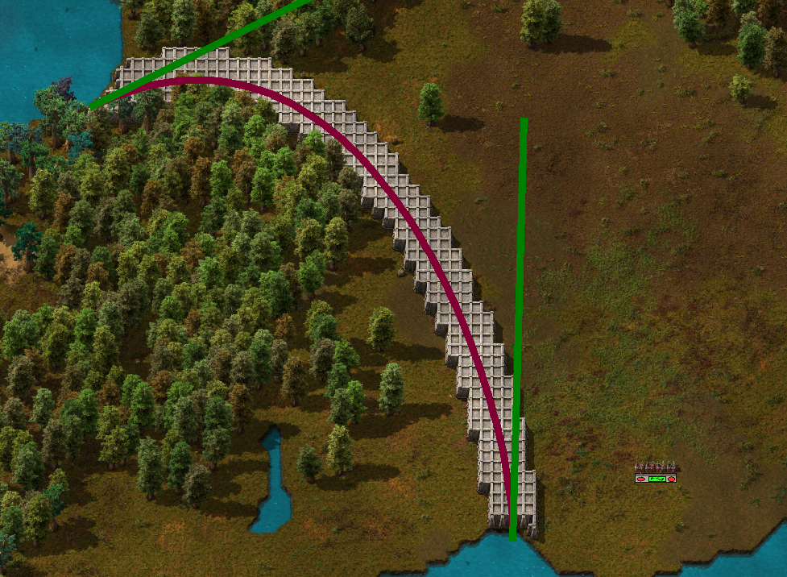

# Bézierio

A Factorio 2.1 mod for building walls, floors, power lines and turret rows along a curve.

> The screenshots are from 0.1, which used a "curve projector" building driven by
> circuit signals. Since 0.2 everything is done from the Bézierio window instead.

## How to use

1. Click the **Bézierio** button in the top-left button bar to open the window.
2. **Draw the curve with the pointer.** Take it with the pointer button in the
   window or <kbd>Alt</kbd>+<kbd>B</kbd>, then:
   - click empty ground to add a point at the end;
   - click a point to select it; while a point is selected, clicking moves it
     there (it stays selected, so you can keep adjusting it);
   - <kbd>Shift</kbd> + click near the curve to insert a point there (beyond an end,
     it's added before the first or after the last point);
   - <kbd>Shift</kbd> + mouse wheel selects the next or previous point;
   - right-click deselects, or removes the point under the cursor.

   The curve passes through every point, in order. Tick **Closed loop** to join
   the last point back to the first; the ⇄ button reverses the point order (the
   curve runs the other way, so the layers swap sides). The point list in the
   window shows each point's coordinates: click a point's name to select it, type
   new coordinates and press <kbd>Enter</kbd>, or remove a point with its ✕. The
   trash button removes all points.
3. Toggle **Draw** to see the curve and its points.
4. **Set up layers** in the layer list. Pick a layer to edit it in the pane below
   the list.
   - **Layer 0** runs along the middle of the curve.
   - **Layers 1, 2, …** stack to the right of the direction of travel (P1 → last
     point), **layers −1, −2, …** to the left. Use the **+** buttons to add layers
     above or below, and the arrows to reorder them.
   - **Walls and tiles** fill a band. *Width* sets its thickness. *Checkerboard*
     leaves out alternating squares of the given size; the sign picks which squares.
     A tile layer with *Under entities* takes no room: the next layers out are
     built on top of its tiles.
   - **Electric poles, electric turrets and roboports** are placed every
     *Spacing* tiles along the middle of their band. Poles stay within wire reach of
     each other (extra poles are added where needed), get copper wire, and red and
     green wire too if you tick *Circuit wires*.
   - *Offset* leaves a gap between a layer and the one inside it. An empty layer
     acts as a 1-tile spacer.
   - Picking another item (or quality) for a layer keeps its settings where the
     new item has the same ones.
5. Toggle **Preview** to see what would be placed, coloured by layer. The window
   shows the curve's length and how many of each item (and quality) the build
   needs; hover it for the count per layer. Red circles mark bends too tight for
   the layers on their inside (those layers split there). The colour picker
   button opens the view settings: colours, curve width and preview opacity.
6. **Build.**
   - **Force build** places ghosts and marks trees and rocks for deconstruction.
     Spots blocked by anything else are skipped.
   - **Super force build** also marks your own buildings in the way for
     deconstruction.

   Robots, or you, then build the ghosts. A whole build is one undo step
   (<kbd>Ctrl</kbd>+<kbd>Z</kbd>).

   In the map editor or with cheat mode on, both buttons build the real entities
   and tiles straight away. Trees, rocks and (with super force) your buildings in
   the way are removed instead of marked, and existing ghosts on the curve are
   revived.

Big curves take a moment: planning, preview and building are spread over several
ticks so the game keeps running smoothly. The status line in the window shows the
progress. *Work per tick* in the map settings trades speed against smoothness. In
the map editor, unpause the game, or nothing happens.

## Compatibility

- Factorio 2.1, base game.
- Space age: supports switching between surfaces
- Quality: you can pick the buildable quality

Feedback and crash logs are welcome on the mod portal or on GitHub.
