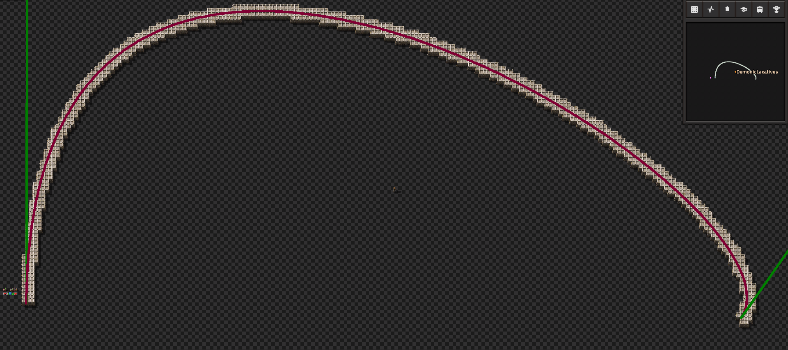

# Bézierio

A Factorio 2.1 mod for building walls, floors, power lines and turret rows along a curve.

> The screenshots are from 0.1, which used a "curve projector" building driven by
> circuit signals. Since 0.2 everything is done from the Bézierio window instead.

## How to use

1. Click the **Bézierio** button in the top-left button bar to open the window.
2. **Draw the curve with the pointer.** Take it with the pointer button in the
   window or <kbd>Alt</kbd>+<kbd>B</kbd>, then:
   - click empty ground to add a point at the end;
   - click a point to select it; while a point is selected, clicking moves it
     there (it stays selected, so you can keep adjusting it);
   - <kbd>Shift</kbd> + click near the curve to insert a point there (beyond an end,
     it's added before the first or after the last point);
   - <kbd>Shift</kbd> + mouse wheel selects the next or previous point;
   - right-click deselects, or removes the point under the cursor.

   The drop-down next to the pointer button picks what to draw: a **curve**
   through any number of points, or a **circle**, **ellipse** or **arc**, placed
   with the pointer like the curve's points (the window says which handle to click
   next):
   - circle: the centre, then a point on the circle;
   - ellipse: the centre, the end of one axis (its radius and the rotation), then a
     point whose distance from that axis sets the other radius;
   - arc: the centre, the start (sets the radius), then the end (only its
     direction counts); the arc runs clockwise from start to end.

   The map shows how the handles are used (the ellipse's axes, and where the
   width and end handles actually land), and the window shows the resulting radii
   and arc angle. Each keeps its own points, so you can switch back and forth. Dragging a shape's
   centre moves the whole shape. The **move** button makes clicks move the curve's
   centre to where you click; right-click to stop.

   The curve passes through every point, in order. Tick **Closed loop** to join
   the last point back to the first; the ⇄ button reverses the curve's direction, leaving the points as they are
   (so the layers swap sides; for a circle, inside and outside). The point list in the
   window shows each point's coordinates (the export / import buttons copy the
   whole curve as a string, e.g. to share it or report a problem): click a point's name to select it, type
   new coordinates and press <kbd>Enter</kbd>, or remove a point with its ✕. The
   trash button removes all points.
3. Toggle **Draw** to see the curve and its points.
4. **Set up layers** in the layer list. Pick a layer to edit it in the pane below
   the list. Layer stacks are saved as **presets**: the bar above the list
   switches between them, and copies, renames, deletes, exports or imports them
   (export gives a string to share; import takes one).
   - **Layer 0** runs along the middle of the curve.
   - **Layers 1, 2, …** stack to the right of the direction of travel (P1 → last
     point), **layers −1, −2, …** to the left. Use the **+** buttons to add layers
     above or below, and the arrows to reorder them. The ⇅ button mirrors the
     stack: every layer moves to the other side of the curve.
   - **Walls and tiles** fill a band. *Width* sets its thickness. Where a wall
     lands on an existing straight rail, it becomes a gate (*Gates on rails*). *Checkerboard*
     leaves out alternating squares of the given size; the sign picks which squares.
     A tile layer with *Under entities* takes no room: the next layers out are
     built on top of its tiles.
   - **Electric poles, electric turrets and roboports** are placed every
     *Spacing* tiles along the middle of their band. Poles stay within wire reach of
     each other (extra poles are added where needed), get copper wire, and red and
     red and/or green wire too if you tick *Red wire* / *Green wire*. With *Smart placement*, poles go as
     far apart as the wires reach, but closer where needed so that every powered
     entity in the build (turrets, roboports, ...) gets power, like dragging poles
     in the game.
   - **Turrets** (gun, flamethrower, artillery, laser, ... and the Space Age ones),
     **radars**, **solar panels**, **accumulators** and **lamps** are placed every
     *Spacing* tiles too.
     - Turrets that can't turn all the way round (flamethrower, railgun) face
       *Outward* (away from the curve) or *Inward*, diagonally too.
     - Ammo turrets can request *Ammo*: ghosts get it delivered with them; in the
       map editor or cheat mode they're loaded straight away. The totals include it.
     - Ammo turrets can get an *Inserter* each, taking ammo from a belt layer: put
       the belt layer beside the turrets with an empty row between (the turret
       layer's *Offset*), as far as the inserter reaches. Fluid turrets can get a
       *Pipe feed*: a short pipe from one of their connections to a pipe layer
       beside them. Turrets whose feed doesn't fit are shown as unfed.
     - Radar spacing defaults to a bit less than the area a radar keeps revealed.
     - Lamps keep their own colour, take one colour, or a *Rainbow* that cycles
       along the curve.
   - **Belts and pipes** run as continuous lines along the curve, *Lines* of them
     side by side with a *Gap* between (pipes keep at least one empty cell, or
     neighbouring lines would join). Belts flow along or against the curve
     (*Flow*). *Undergrounds* takes long straight runs underground. Pipes can get
     *Pumps* every *Pump spacing* tiles (at most the pipe's pipeline extent limit),
     so long pipelines keep flowing (in the
     *Flow* direction). Undergrounds and pumps are in the totals.
   - **Rails** follow the middle of their band, fitted from the game's own rail
     pieces (straight, diagonal and curved). Bends tighter than rails can take are
     marked in the preview. *Signal spacing* puts a rail signal every so many
     wagons (0: none), on the side trains travel (*Direction of travel*; *Both
     ways* signals both sides). Where the track crosses one of your walls, the
     walls under it become gates (*Gates in walls*). With Space Age's elevated rails,
     *Elevated* builds the track on supports (placed for you, as far apart as they
     reach), with *Ramps* up at the start and down at the end; ramps only go on
     straight north/south/east/west track, so start and end the curve that way.
     Rails take more room than one tile: keep wall layers an *Offset* away, or
     the track cuts through them.
   - **Land mines** cover their band (up to 63 tiles wide), *Scattered* (*Density*
     is the share of cells that get one, the same cells every time) or on a
     *Grid* (every *Spacing* tiles). *Red wire* / *Green wire* connect them.
   - The checkbox in front of a layer shows or hides it in the preview (it's
     built either way).
   - *Offset* leaves a gap between a layer and the one inside it. An empty layer
     acts as a 1-tile spacer.
   - Picking another item (or quality) for a layer keeps its settings where the
     new item has the same ones.
5. Toggle **Preview** to see what would be placed, coloured by layer, with arrows
   for which way belts flow and turrets face. The window
   shows the curve's length and how many of each item (and quality) the build
   needs (also after a build without the preview, until the next edit); hover it
   for the count per layer. Red circles mark bends too tight for
   the layers on their inside (those layers split there). The colour picker
   button opens the view settings: colours, curve width and preview opacity.
6. **Build.**
   - **Force build** places ghosts and marks trees and rocks for deconstruction.
     Spots blocked by anything else are skipped.
   - **Super force build** also marks your own buildings in the way for
     deconstruction.

   Robots, or you, then build the ghosts. A whole build is one undo step
   (<kbd>Ctrl</kbd>+<kbd>Z</kbd>).

   After a build, entities that won't get power (*N unpowered*) or ammo/fluid
   (*N unfed*) from it are marked on the map for a minute. Click those warnings in
   the window to show or hide the marks; how long they stay is a per-player mod
   setting (0: until hidden). They go with the warnings when you edit the curve
   or layers.

   - **Blueprint** puts the build in your cursor as a blueprint instead. It snaps
     onto the preview, so the first click places it exactly there, and further
     copies line up end to end. Rotate, share or store it like any blueprint.
     It also carries the curve and preset it was made from: hold it (from your
     inventory, a blueprint book or the blueprint library) and click **Load from
     blueprint** to get them back, the preset added as a new one. A per-player mod
     setting turns this off.

   In the map editor or with cheat mode on, both buttons build the real entities
   and tiles straight away. Trees, rocks and (with super force) your buildings in
   the way are removed instead of marked, and existing ghosts on the curve are
   revived.

Big curves take a moment: planning, preview and building are spread over several
ticks so the game keeps running smoothly. The status line in the window shows the
progress. *Work per tick* in the map settings trades speed against smoothness. In
the map editor, unpause the game, or nothing happens.

## Compatibility

- Factorio 2.1, base game.
- Space age: supports switching between surfaces
- Quality: you can pick the buildable quality

Feedback and crash logs are welcome on the mod portal or on GitHub.
