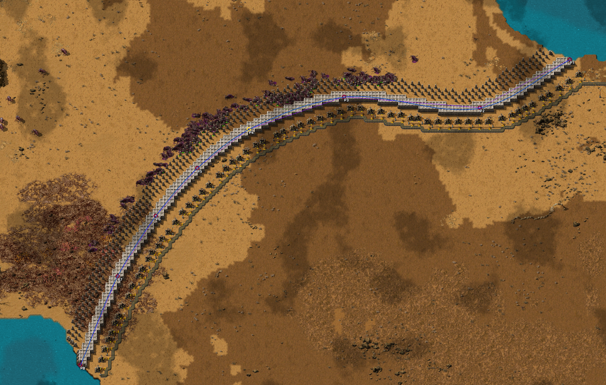
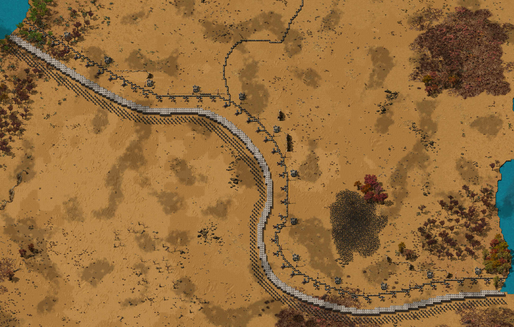
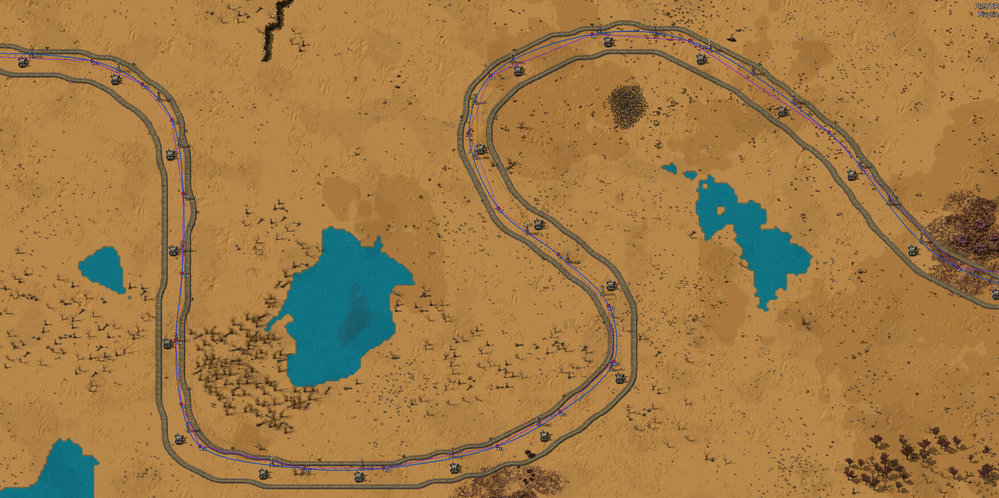

# Bézierio

Draw a curve, stack up layers of walls, floors, power lines, turrets, belts, pipes
or rails along it, and build the lot in one go: as ghosts for your robots, as a
blueprint, or straight away in the map editor.

## What it does

- **Curves:** a smooth curve through any number of points, or a circle, ellipse
  or arc, open or closed, placed with a pointer on the map.
- **Layers** side by side along the curve, each with its own item and settings:
  - walls and floor tiles (also under the other layers), in a checkerboard if
    you like;
  - electric poles, wired red and green, or placed smartly so everything in the
    build gets power;
  - turrets facing outward or inward, with ammo, targeting priorities, and an
    inserter or pipe feed from a belt or pipe layer next to them;
  - radars, solar panels, accumulators, roboports, lamps (one colour, or a
    rainbow along the curve) and land mines;
  - belts and pipes as continuous lines, with undergrounds and pumps;
  - rails fitted from the game's own pieces, with signals, gates where they
    cross your walls, and elevated track with supports and ramps.
- **Presets:** save layer stacks, and share them (or curves) as strings.
- **Builds** like the game's: Build, Force build (clears trees, rocks and cliffs,
  lays landfill, foundation or other cover where needed) and Super force build.
  A whole build is one undo step.
- **Blueprints** that snap onto the preview and remember the curve and preset
  they were made from.
- Big builds are spread over many ticks, so the game keeps running smoothly.

## How to use

1. **Open the window** with the Bézierio button at the top left. It has three
   sections: Curve, Layers and Build. In its title bar: the pin keeps it open
   while you use other windows, the gear opens the settings, and the chevrons
   narrow it to the everyday controls.
2. **Draw the curve.** Take the pointer (the pointer button, or Alt+B):
   - click empty ground to add a point at the end;
   - click a point to select it, then click elsewhere to move it there;
   - Shift + click near the curve to insert a point;
   - Shift + mouse wheel selects the next or previous point;
   - right-click deselects, or removes the point under the cursor.

   The drop-down next to the pointer picks a **curve**, **circle**, **ellipse**
   or **arc** (the window says which handle to place next). The circular arrows
   close the loop, ⇄ reverses the direction (the layers swap sides), and the
   point list lets you type coordinates. Export and import share a curve as a
   string.
3. **Toggle Draw** to see the curve and its points.
4. **Set up the layers.** Layer 0 runs along the middle; layers 1, 2, ... stack
   to the right of the direction of travel, −1, −2, ... to the left. Use the +
   bars to add a layer, and its item or settings button to open its settings
   (OK keeps the changes, Cancel or Esc puts it back). Each layer has an Offset
   (gap to the next layer in) and the settings of its kind: width, spacing,
   wires, facing, ammo, lines, signals, and so on (hover them for what they do).
   The two toggles in front of a layer choose whether it's built and whether it's
   drawn in the preview. The preset bar above the list saves and switches layer
   stacks.
5. **Toggle Preview** to see what would be built, coloured by layer. The summary
   shows the length and the items needed (hover for each layer's), and warns
   about bends too tight for the inner layers, pole gaps, and entities that won't
   get power, ammo or fluid (click a warning to mark them on the map).
6. **Build:**
   - **Build** places ghosts wherever nothing is in the way;
   - **Force build** also marks trees, rocks and cliffs in the way for
     deconstruction, and lays landfill (on water), foundation (on lava) or other
     cover where the ground can't take what's planned (which cover comes first is
     a setting);
   - **Super force build** also marks your own buildings in the way;
   - **Blueprint** puts the build in your cursor, snapping onto the preview.
     **Load from blueprint** gets the curve and preset back from it.

   In the map editor or cheat mode, the build is real straight away. A build is
   one undo step (Ctrl+Z). While it plans or builds, the summary shows the
   progress; its ✕ cancels.

Planning, preview and building take a moment for big curves; *Work per tick* in
the map settings trades speed against smoothness. In the map editor, unpause the
game, or nothing happens.

## Compatibility

- Factorio 2.1.
- Space Age: works on every surface, with its turrets, foundation, ice platform
  and elevated rails.
- Quality: pick the quality to build.

Feedback and crash logs are welcome on the mod portal or on GitHub.
