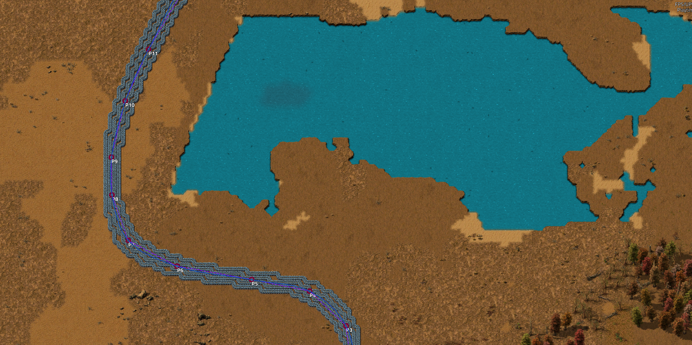
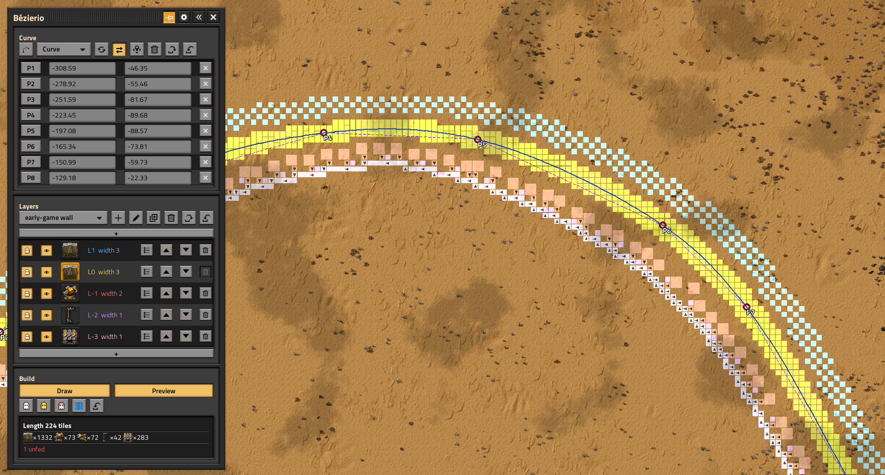

# Bézierio

Draw a curve, stack up layers of walls, floors, power lines, turrets, belts, pipes or rails along it, and build the lot in one go: as ghosts for your robots, as a blueprint, or straight away in the map editor.

## Escape the grid

## Exploit choke points

## Adapt to the world

## Go nuts!

## All of it controlled from a GUI

## What it does

- **Curves:** a smooth curve through any number of points, or a circle, ellipse or arc, open or closed, placed with a pointer on the map.
- **Layers** side by side along the curve, each with its own item and settings:
    - walls and floor tiles, in a checkerboard if you like;
    - electric poles, wired red and green, or placed smartly so everything in the build gets power;
    - turrets facing outward or inward, with targeting priorities, and an inserter or pipe feed from a belt or pipe layer next to them;
    - radars, solar panels, accumulators, roboports, lamps, land mines;
    - belts and pipes as continuous lines, with undergrounds and pumps;
    - rails following the curve as best they can, with signals; elevated rails supported.
- **Presets:** save layer stacks, and share them (or curves) as strings.
- **Builds** like the game's: Build, Force build and Super force build. One build order is just one undo step.
- **Blueprints** that snap onto the preview and remember the curve and preset they were made from.
- Calculations, planning and building are all spread over many ticks, so the game keeps running smoothly.

## How to use

1. **Open the window** with the Bézierio button at the top left. It has three sections: Curve, Layers and Build.

2. **Draw the curve.** Take the pointer (the pointer button, or Alt+Z):

    - click empty ground to add a point at the end;
    - click a point to select it, then click elsewhere to move it there;
    - Shift + click near the curve to insert a point;
    - Alt + mouse wheel selects the next or previous point;
    - right-click deselects, or removes the point under the cursor.

    The drop-down next to the pointer picks a **curve**, **circle**, **ellipse** or **arc** (the window says which handle to place next). The circular arrows close the loop, ⇄ reverses the direction (the layers swap sides), and the point list lets you type coordinates. Export and import share a curve as a string.

3. **Toggle Draw** to see the curve and its points.

4. **Set up the layers.**

    - layer 0 runs along the middle; layers 1, 2, ... stack to the right of the direction of travel, −1, −2, ... to the left;
    - use the + bars to add a layer;
    - configure a layer with its item or settings button:
        - its kind, specified by the item type you choose;
        - an Offset (gap to the next layer in);
        - the settings of its kind: width, spacing, wires, facing, ammo, lines, signals, and so on (hover for tooltips);
    - the two toggles in front of a layer choose whether it's built and whether it's drawn in the preview;
    - the preset bar above the list saves and switches layer stacks.

5. **Toggle Preview** to see what would be built, coloured by layer. The summary shows the length and the items needed, and warns about bends too tight for the inner layers, pole gaps, and entities that won't get power, ammo or fluid (click a warning to highlight them).

6. **Build:**

    - **Build** places ghosts wherever nothing is in the way;
    - **Force build** also marks trees, rocks and cliffs in the way for deconstruction, and lays landfill (on water), foundation (on lava) and so on where the ground can't take what's planned;
    - **Super force build** also marks for deconstruction your own buildings that are in the way;
    - **Generate blueprint** puts the build in your cursor, snapping onto the preview. **Load from generated blueprint** gets the curve and preset back from it.

    In the map editor or cheat mode, the build is real straight away. While it plans or builds, the summary shows the progress; its ✕ cancels it.

Planning, preview and building take a moment for big curves; *Work per tick* in the map settings trades speed against smoothness.

## Known issues
Some issues will crop up, and some manual post-processing is expected.

- Sometimes layers collide and override each other.
- Parallel belts in the same layer can collide with one another.
- Turrets don't always get properly fed; in most cases there should be a warning on that.

## Compatibility

- Factorio 2.1.
- Space Age: works on every surface, with its turrets, foundation, ice platform and elevated rails.
- Quality: pick the quality to build with.

Feedback and crash logs are welcome on the mod portal or on GitHub.
